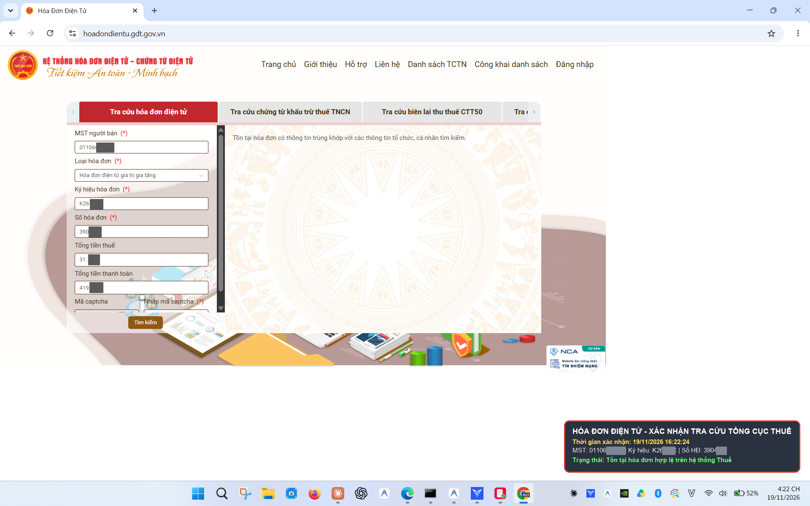
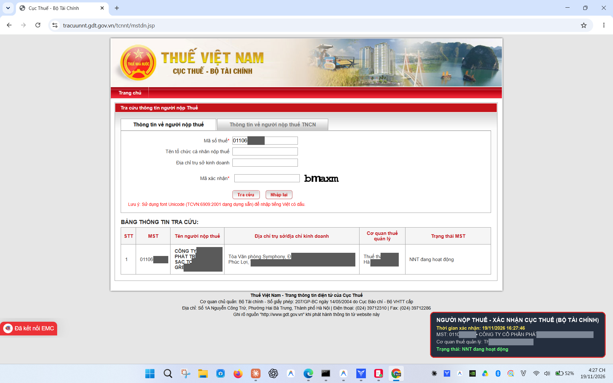
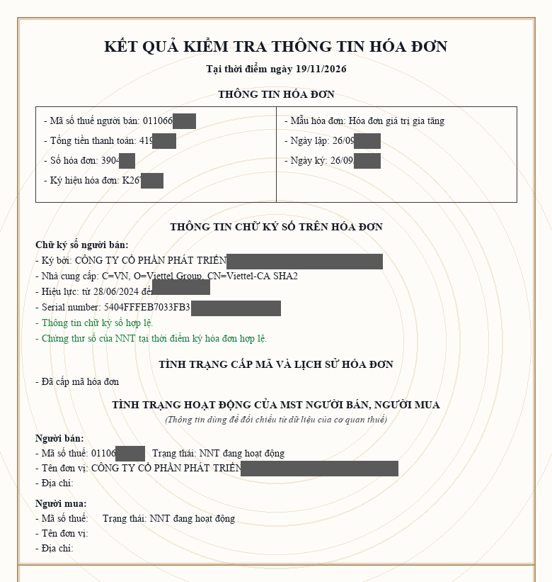
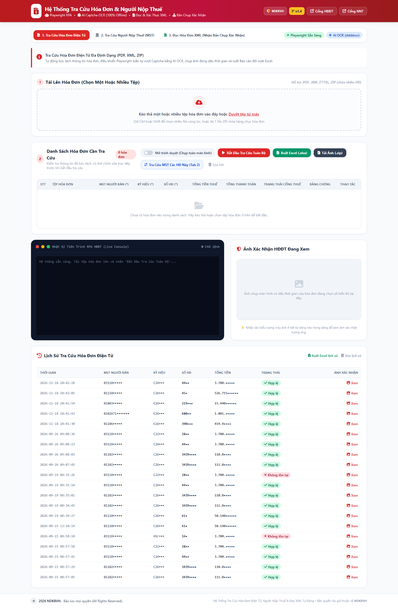
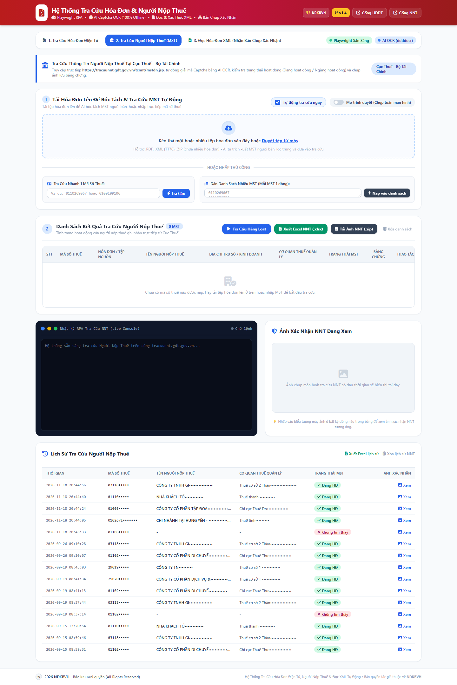
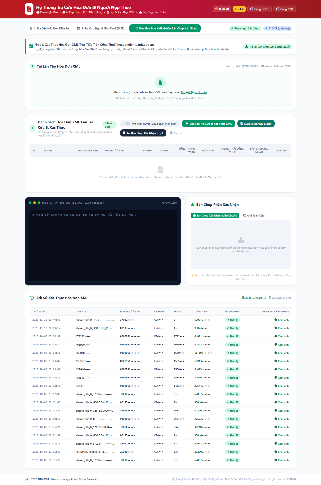
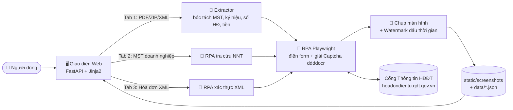

# 🧾 CheckHoaDon – Tra Cứu Hóa Đơn Điện Tử & Người Nộp Thuế Tự Động


> **Một giao diện web – ba nghiệp vụ tra cứu – toàn bộ thao tác trên Cổng Thông tin Hóa đơn điện tử của Tổng cục Thuế được robot hóa.**
>
> Tải hóa đơn lên (PDF / XML / ZIP) hoặc nhập MST, hệ thống tự bóc tách thông tin, điền form, tự giải mã Captcha bằng AI và **chụp ảnh màn hình có đóng dấu thời gian** làm bằng chứng đối soát.

### 🖼️ Kết quả bằng chứng mẫu do hệ thống tự chụp

Mỗi lần tra cứu, robot tự chụp toàn màn hình (kèm thanh địa chỉ, đồng hồ Taskbar) và đóng **badge xác nhận có dấu thời gian** ở góc dưới phải:

<table>
  <tr>
    <td width="33%"></td>
    <td width="33%"></td>
    <td width="33%"></td>
  </tr>
  <tr>
    <td align="center"><b>Tab 1</b> – Xác nhận hóa đơn tồn tại trên Cổng Thuế</td>
    <td align="center"><b>Tab 2</b> – Xác nhận người nộp thuế đang hoạt động</td>
    <td align="center"><b>Tab 3</b> – Bản chụp phần xác nhận hóa đơn XML</td>
  </tr>
</table>

> 🔒 Ảnh minh họa đã được **che một nửa các thông tin định danh** (MST, số hóa đơn, tên đơn vị, địa chỉ, số tiền, số serial chứng thư số…).

---

## ✨ Tính năng nổi bật

| | Tính năng | Mô tả |
|---|---|---|
| 📄 | **Bóc tách hóa đơn đa định dạng** | Đọc `PDF` (kể cả bản in giãn chữ, layout nhiều cột), `XML` theo Thông tư 78 / Nghị định 123 và `ZIP` hàng loạt. |
| 🔎 | **Tra cứu tự động trên Cổng Thuế** | Robot Playwright mở trình duyệt, điền MST, ký hiệu, số HĐ, ngày lập, loại hóa đơn, chọn đúng mục trong dropdown. |
| 🤖 | **Tự giải Captcha bằng AI** | `ddddocr` nhận diện ký tự; ảnh SVG được render sang PNG 2× để tăng độ chính xác; tự làm mới và thử lại tối đa 6 lần. |
| 🖼️ | **Ảnh bằng chứng có dấu thời gian** | Chụp toàn màn hình (kèm thanh địa chỉ web và đồng hồ Taskbar), đóng dấu giờ, MST, số HĐ và trạng thái xác nhận. |
| 🏢 | **Tra cứu Người Nộp Thuế** | Tra cứu thông tin doanh nghiệp theo MST tại Cục Thuế, có lịch sử và xuất Excel. |
| 📑 | **Xác thực hóa đơn XML** | Đọc và xác thực hóa đơn XML trực tiếp trên Cổng Thuế, xuất bản chụp phần xác nhận và thẻ chứng nhận. |
| 📊 | **Xuất Excel & tải ảnh hàng loạt** | Xuất kết quả ra `.xlsx`, tải gói ảnh xác nhận chỉ với một cú nhấp. |
| 🖥️ | **Giao diện web trực quan** | Kéo-thả tệp, xem trước & sửa trường trước khi chạy, console tiến trình theo thời gian thực, lightbox xem ảnh. |

---

## 📸 Ảnh demo giao diện

> 🔒 Dữ liệu trong ảnh là lịch sử tra cứu thật đã được **che một nửa nội dung mỗi ô** (MST, tên, số hóa đơn, số tiền…) và làm mờ ảnh bằng chứng trước khi chụp.

**Tab 1 – Tra cứu hóa đơn điện tử (PDF / XML / ZIP)**



**Tab 2 – Tra cứu người nộp thuế theo MST**



**Tab 3 – Đọc & xác thực hóa đơn XML**



---

## 🧭 Ba nghiệp vụ chính



| Tab | Nghiệp vụ | Đầu vào | Kết quả |
|---|---|---|---|
| **1** | Tra cứu hóa đơn điện tử | PDF / XML / ZIP (hoặc nhập tay) | Trạng thái tồn tại hóa đơn + ảnh xác nhận có dấu thời gian |
| **2** | Tra cứu người nộp thuế | Mã số thuế (nhập tay hoặc tải từ tệp) | Thông tin NNT + lịch sử + xuất Excel |
| **3** | Đọc & xác thực hóa đơn XML | Tệp XML (hoặc hàng loạt) | Kết quả xác thực + bản chụp phần xác nhận + thẻ chứng nhận |

---

## 🛠️ Công nghệ sử dụng

- **Backend:** FastAPI · Uvicorn · Pydantic · Jinja2
- **RPA & trình duyệt:** Playwright (Chromium) · Win32 API (chụp màn hình toàn desktop)
- **Xử lý tài liệu:** PyMuPDF · pdfplumber · xlsxwriter
- **AI nhận diện Captcha:** ddddocr · OpenCV · Pillow
- **Frontend:** HTML/CSS/JavaScript thuần, Tailwind-style utility, SSE/polling cho console tiến trình
- **Đóng gói:** C# launcher (`launcher.cs`) · Inno Setup (`installer_setup.iss`) · script `package.py`

---

## 📂 Cấu trúc dự án

```
CheckHoaDon/
├── app.py                 # Máy chủ FastAPI & toàn bộ API điều phối
├── extractor.py           # Bóc tách dữ liệu hóa đơn (PDF / XML / ZIP)
├── rpa_engine.py          # RPA Tab 1 & Tab 3 (điền form, giải Captcha, chụp ảnh)
├── rpa_nnt.py             # RPA Tab 2 – tra cứu người nộp thuế
├── screen_capture.py      # Chụp toàn màn hình Windows, focus cửa sổ trình duyệt
├── watermark.py           # Đóng dấu thời gian & badge xác nhận lên ảnh
├── excel_export.py        # Xuất kết quả ra Excel
├── start_app.py           # Khởi chạy máy chủ & mở trình duyệt
├── run.bat / doi_cong.bat # Chạy 1-click trên Windows / đổi cổng
├── dong_goi.bat           # Đóng gói bộ cài 1-click (gọi package.py)
├── package.py             # Tự tăng phiên bản, biên dịch launcher, tạo bộ cài & ZIP
├── launcher.cs            # Launcher native C# (EXE)
├── installer_setup.iss    # Kịch bản Inno Setup
├── requirements.txt       # Thư viện Python cần thiết
├── VERSION.txt            # Số phiên bản hiện tại
├── templates/index.html   # Giao diện web chính
└── static/
    ├── css/ · js/         # Kiểu dáng & logic phía client
    ├── uploads/           # Tệp tải lên tạm (không đưa lên Git)
    └── screenshots/       # Ảnh xác nhận có dấu thời gian (không đưa lên Git)
```

---

## 🚀 Cài đặt & chạy

### Yêu cầu
- **Windows 10/11** (chức năng chụp toàn màn hình dùng Win32 API)
- **Python 3.12**
- Kết nối Internet tới `hoadondientu.gdt.gov.vn`

### Các bước

```powershell
# 1. Tạo môi trường ảo và cài thư viện
python -m venv .venv
.\.venv\Scripts\activate
pip install -r requirements.txt

# 2. Cài trình duyệt Chromium cho Playwright
python -m playwright install chromium

# 3. Khởi chạy (tự mở http://127.0.0.1:8000)
python start_app.py
```

Hoặc chạy nhanh bằng **`run.bat`** (tự nhận diện môi trường, tự cài thư viện còn thiếu nếu chưa có).

> Cổng mặc định là `8000` (đọc từ `PORT.txt`, có thể ghi đè bằng tham số `--port` hoặc biến môi trường `CHECKHOADON_PORT`).

---

## 🧑‍💻 Hướng dẫn sử dụng nhanh

1. **Tải hóa đơn** – kéo thả `.pdf`, `.xml` hoặc `.zip` vào khung tải lên.
2. **Kiểm tra thông tin** – hệ thống tự điền MST, ký hiệu, số HĐ, loại hóa đơn, tiền. Bạn có thể sửa trước khi chạy.
3. **Chọn chế độ** – *Mở trình duyệt* để quan sát robot làm việc, hoặc bật *Chạy ngầm* để chạy nhanh.
4. **Bắt đầu** – bấm nút tra cứu và theo dõi Console.
5. **Nhận kết quả** – ảnh xác nhận có dấu thời gian hiển thị ngay, tải về bằng một nút.

---

## 🔌 Các API chính

| Phương thức | Đường dẫn | Chức năng |
|---|---|---|
| `POST` | `/api/upload` | Tải & bóc tách hóa đơn (Tab 1) |
| `POST` | `/api/lookup` | Chạy RPA tra cứu hóa đơn |
| `GET` | `/api/logs/{job_id}` | Lấy log tiến trình của một tác vụ |
| `GET` / `DELETE` | `/api/history` | Xem / xóa lịch sử tra cứu hóa đơn |
| `POST` | `/api/export-excel` | Xuất kết quả Excel |
| `POST` | `/api/nnt/upload` · `/api/nnt/lookup` | Tra cứu người nộp thuế (Tab 2) |
| `POST` | `/api/xml/upload` · `/api/xml/lookup` | Xác thực hóa đơn XML (Tab 3) |
| `POST` | `/api/xml/download-batch-certificates` | Tải gói thẻ chứng nhận hàng loạt |

Tài liệu tương tác tự động của FastAPI có tại `http://127.0.0.1:8000/docs`.

---

## 🔐 Quyền riêng tư & dữ liệu

Dự án xử lý **hóa đơn thật** nên được thiết kế để dữ liệu nằm **trên máy của bạn**:

- Lịch sử tra cứu (`data/*.json`), ảnh xác nhận (`static/screenshots/`), tệp tải lên (`static/uploads/`) **không** được đưa lên Git – đã được khai báo trong `.gitignore`.
- Hóa đơn mẫu và hóa đơn đã dùng để kiểm thử (`HoaDonTest/`, `sample_invoices/`) **không** nằm trong kho mã nguồn.
- Không có khóa API hay thông tin đăng nhập nào được lưu trong mã nguồn. Hãy giữ tệp `.env` (nếu có) ở máy cục bộ.

> Khi cần chia sẻ mẫu để kiểm thử, hãy dùng hóa đơn đã **che thông tin nhạy cảm** (MST, họ tên, số tài khoản).

---

## 📦 Đóng gói bộ cài Windows

```powershell
dong_goi.bat            # Tự tăng phiên bản, biên dịch launcher, build bộ cài Inno Setup và tạo ZIP
```

Tương đương: `python package.py --bump minor|patch|major`. Yêu cầu đã cài **Inno Setup** (có `ISCC.exe`). Sản phẩm đầu ra nằm trong thư mục `dist/` (không đưa lên Git; nên phát hành qua *GitHub Releases*).

---

## 🗺️ Lộ trình

- [ ] Đa luồng (concurrency) khi tra cứu hàng loạt hóa đơn XML / MST lớn
- [ ] Xuất báo cáo PDF tổng hợp kèm các ảnh xác nhận

---

## ☕ Ủng hộ dự án

Nếu công cụ giúp bạn tiết kiệm thời gian đối soát hóa đơn, bạn có thể ủng hộ tác giả một ly cà phê để dự án tiếp tục được cải tiến. Xin cảm ơn! 💚

<p align="center">
  
</p>

---

## 📜 Bản quyền

**Copyright © 2026 NDKBVH. Bảo lưu mọi quyền.** Xem chi tiết tại [COPYRIGHT.md](COPYRIGHT.md).

Dự án phục vụ mục đích đối soát, kiểm tra hóa đơn hợp pháp. Người dùng tự chịu trách nhiệm tuân thủ điều khoản sử dụng của Cổng Thông tin Hóa đơn điện tử do Tổng cục Thuế cung cấp.
